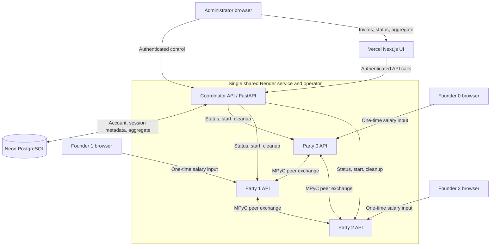
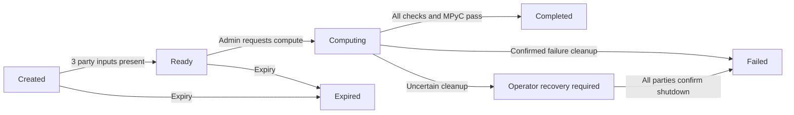

# VEILBENCH — Academic Technical Project Report

**Title:** Privacy-Preserving Startup Founder Salary Benchmarking Using Secure Multiparty Computation  
**Report version:** Phase F draft 1 | **Evidence cutoff:** 25 November 2026  
**Implementation basis:** [VEILBENCH GitHub repository](https://github.com/ijin-003/VEILBENCH)  
**Scope:** Deployed academic **proof of concept**, not an independently hosted, production-grade privacy service.

> **Report integrity:** This document describes verified source code, test evidence and known deployment limitations. It is *not* a substitute for a course-provided marking rubric, and must not be labeled compliant with an unseen rubric. A verified backend CI run, a live deployment and a successful student-led browser test are different evidence types. Do not promote unmeasured hosted latency or untested malicious-security guarantees to factual results.

## Abstract

Salary benchmarking is useful to founders, but ordinary centralized surveys require participants to disclose individual salary figures to a collecting service. VEILBENCH demonstrates a different workflow: exactly three authenticated founders submit synthetic salaries to three logically separate party services, which use the **MPyC** Python framework and **Shamir secret sharing** to compute the **sum** and **average**. The coordinator orchestrates input receipt and the MPC computation but has no salary-input API. Results and essential session metadata are stored in PostgreSQL; individual salary values are intentionally absent from the coordinator's relational database.

The deployed frontend uses **Next.js** on Vercel. A **FastAPI** backend, coordinator and three logical MPC party applications are hosted together in one **Render** container, and **Neon PostgreSQL** stores account/session metadata and completed aggregates. This architecture demonstrates functioning three-party MPyC, authentication, input isolation at the application-route level and reproducible automated security checks. **It does not demonstrate confidentiality against the shared Render operator**: one host controls all three logical parties and can access process memory. Consequently, the hosted prototype is limited to **synthetic data only**.

The local CI test validated the aggregate of 50,000, 70,000 and 60,000 as 180,000, with a mean of 60,000. Two six-run local MPyC benchmark campaigns reported median times of **179.73 ms** and **242.20 ms**, respectively. These numbers **must not** be reported as production Vercel–Render HTTP timings; three hosted `Server-Timing` measurements remain to be collected.

## 1. Problem and motivation

A conventional central benchmark server receives each user's salary, calculates a sum and an average, and therefore has access to every submitted value. VEILBENCH's design separates **account and session orchestration** from **private input receipt** and reconstructs only a permitted aggregate.

**Research question:** Can a three-founder salary-benchmark demonstration calculate correct group statistics using real MPC without routing individual plaintext salaries through the central coordinator API?

**Objectives**
1. Implement genuine three-party MPyC secure summation, fixed to three parties with threshold one.
2. Send each founder's input to their individually assigned party endpoint rather than the coordinator.
3. Authenticate administrators and founders, issue short-lived invitations and restrict cross-party actions.
4. Reveal sum and average only after all three inputs are accepted; persist the aggregate, not individual values.
5. Test authorization, replay prevention, missing-party behavior, recovery and performance in disposable environments.
6. Deploy a responsive, explainable academic web interface with accurate security caveats.

**Out of scope:** production handling of real salaries; independent operators for the three parties; malicious-party Byzantine resilience; guaranteed service uptime; password recovery and account reuse across different benchmark sessions.

## 2. Implemented system architecture



**Diagram interpretation:** The arrows show logical paths, not separate independent network hosts. The coordinator and all three party applications share a Render container and operator. Public HTTPS terminates at Render, while the demo's internal party communication occurs on loopback without independent-operator mutual TLS. Each party uses a dedicated module-level state and launches its MPyC computation subprocess. Therefore the deployed security boundary is weaker than the formal model of three mutually distrustful organizations.

| Layer | Implementation | Verified role |
|---|---|---|
| Browser UI | Next.js / React, deployed on Vercel | Admin and participant workflows; account activation; reactor/aggregate scenes |
| Coordinator | FastAPI, SQLAlchemy asyncio | Authenticated session creation, status, compute and recovery without a salary-input route |
| Three logical party services | FastAPI party apps under `/party/0`, `/party/1`, `/party/2` | Direct founder inputs, party-specific tokens, one-time state and actual MPyC processes |
| MPC engine | `mpyc` in Python | Threshold secret sharing, protected arithmetic, reconstruction of sum |
| Persistent storage | Neon PostgreSQL | Accounts, hashed login/invitation metadata, benchmark metadata, sum/mean |
| Transient state | Party application memory + SQLite replay metadata | In-progress input in volatile memory; durable one-use guards only as far as host filesystem persists |
| Host | Render single-container academic demo | One shared security and failure domain, not independent operators |

**Source anchors:** `backend/ops/free_host_app.py`, `scripts/start_free_host.py`, `backend/api/sessions.py`, `backend/mpc/party_service.py`, `backend/mpc/distributed_coordinator.py`, `backend/models/session.py`, and `docs/ZERO_BUDGET_DEPLOYMENT.md`.

## 3. Mathematical methodology

Let the synthetic salaries be `s0`, `s1`, `s2`, with **m = 3** parties and a configured **threshold t = 1**. In Shamir secret sharing over a suitable finite field, a private value `s` can be represented by a random degree-one polynomial:

```text
f(x) = s + a*x (mod p), where a is selected randomly.
```

Each computing party receives an evaluation of the polynomial. A single share does not determine the secret; two valid shares are enough to interpolate a degree-one polynomial under the mathematical model. MPyC manages its underlying secure integer field and peer communication; the application does **not** implement its own custom cryptography.

Each party calls `mpc.input(secint(validated_salary))`, obtains the three secure input shares, and computes their local linear sum. The permitted result is opened by `mpc.output(total_share)`. The public average is computed after opening:

```text
aggregate_sum = s0 + s1 + s2
average_salary = aggregate_sum / 3
Example: 50,000 + 70,000 + 60,000 = 180,000
         180,000 / 3 = 60,000
```

The application checks `len(mpc.parties) == 3` and `mpc.threshold == 1`; the allowable salary input range is **0 to 10,000,000** in the current configuration. It reconstructs **only the aggregate**, not the individual inputs. The full protocol is implemented in `backend/mpc/protocol.py`.

**Security interpretation:** The underlying Shamir threshold secrecy claim assumes shares reside under independently controlled participants and a passive/honest-but-curious adversary. It is **not** a claim of confidentiality from an administrator who controls all three Render logical parties. Further, with only three founders, publishing sum and mean can allow one participant to infer information about others given additional side information; VEILBENCH does not add differential privacy or enforce a large anonymity cohort.

## 4. Authentication and access-control design

The demo administrator is provisioned privately on the backend. Administrators create benchmarking sessions and invite exactly three participants. Each invited participant activates their assigned account, selects a password, logs in and receives a party-scoped capability. The backend enforces single-use submission, expiry and role separation.

As implemented in the released update:
- Login usernames remain **unique** and are the primary key of existing accounts. A one-time invitation or short-lived bearer token is **not** a durable person identifier.
- Passwords are salted and hashed using **scrypt**, never returned by admin directory APIs.
- The activation UI includes a live local password-quality estimate and confirmation field; the API rejects selected weak patterns and enforces a **12–128-character** password length.
- Invitation values can be copied as **token only**; token delivery remains a trusted human operation and must occur via a private channel.
- Account and session directories are administrator-only, paginated and metadata-only. The active-session browser uses remaining server expiry time for its countdown.
- Login tokens are revocable and hashed in database records; authorization and party-specific tokens must not be placed in public URLs or logs.
- Five invalid credential attempts can lock an account for **15 minutes**; a process-local throttle provides an additional, limited protection.

**Important caveat:** Current accounts are assigned to a single benchmark session. Although the account directory lists historical assignments, permanent user registration, reusing an account across different sessions, password reset and migration to UUID-based primary keys are **not** complete. Signup timestamps added later are nullable for legacy accounts rather than fabricated.

**Source anchors:** `backend/api/accounts.py`, `backend/models/account.py`, `backend/security/accounts.py`, `backend/api/sessions.py`, `frontend/src/app/AuthGateway.tsx` and `frontend/src/app/AdminDashboard.tsx`.

## 5. Session lifecycle



Session creation records a random UUID, creation time, expiry, status and submitted-party IDs. A metadata-only route refreshes actual party receipt state. Computing requires all three party IDs and serializes active computation admission using a PostgreSQL advisory lock. On successful completion the coordinator stores sum and average.

A timeout, party restart or unconfirmed shutdown can invalidate the current session or require explicit operator recovery; **the system does not promise seamless automatic recovery**. In this shared-host design, a Render restart can discard volatile inputs. Users then need a fresh synthetic session rather than retrying a consumed invitation.

## 6. Test methods and supporting results

| Test type | What it establishes | Evidence |
|---|---|---|
| Backend regression after admin features | 160 passed, 2 skipped | [GitHub Actions backend tests](https://github.com/ijin-003/VEILBENCH/actions/runs/45099425007) |
| Full-stack isolated acceptance | Administrator and three synthetic founders, invitations, authentic logins, receipt, replay rejection, true MPyC execution, aggregate persistence | [Phase D CI](https://github.com/ijin-003/VEILBENCH/actions/runs/45095940979) |
| Security attack lab | Nine negative-path categories including token tampering, cross-party access, expired/replayed invitations, role isolation and missing peer | [Security lab PR](https://github.com/ijin-003/VEILBENCH/pull/10) — passing lab was run on development branch; PR remains separate |
| Local performance baseline | Six correct measured MPyC subprocess runs, one warmup | [First performance run](https://github.com/ijin-003/VEILBENCH/actions/runs/45075066668) |
| Expanded Phase E evaluation | Six more correct MPyC subprocess runs; missing-party and eight targeted reliability checks pass | [Phase E CI](https://github.com/ijin-003/VEILBENCH/actions/runs/45097787336) |
| Hosted manual demo | User reported successful administrator login and correct salary-result workflow on deployed website | **Manual report; exact timing and fresh post-admin-update UI acceptance not archived** |

**Do not merge the evidence types.** Security-lab and Phase D/Phase E instrumentation live in separately reviewed PRs (see repository links), and an earlier passing CI job does not prove that every test has been merged into the production deployment.

### Phase E observed values

| Metric | Earlier six-run CI baseline | Repeated six-run CI test |
|---|---:|---:|
| Minimum | 175.84 ms | 222.18 ms |
| Median | 179.73 ms | 242.20 ms |
| Mean | 181.21 ms | 239.53 ms |
| Nearest-rank sample p95 / maximum | 188.02 ms | 259.01 ms |
| Largest individual child-process peak RSS | 29,932 KiB | 30,068 KiB |

The sample p95 for only six values equals that run's maximum, and **neither CI run is representative of live Render HTTP latency**. Seven sparse Render memory samples previously ranged from **67.19 to 103.60 MiB**, but they do not establish a service memory ceiling or a computation peak. The queried CPU and HTTP-latency series were unavailable. Consult [Phase E report](https://github.com/ijin-003/VEILBENCH/blob/perf/phase-e-evaluation/docs/PHASE_E_PERFORMANCE_RELIABILITY.md).

## 7. Privacy, security and deployment limitations

| Limit | Practical implication |
|---|---|
| All three parties share one Render operator and container | A host administrator can control or inspect all parties; do **not** enter real salaries |
| Render deployment uses loopback HTTP between logical party apps | Does not provide independent cross-organization mTLS assurance |
| Inputs held in volatile process memory; replay metadata on ephemeral host disk | Restart can invalidate active sessions or remove temporary guard state; recovery requires new sessions |
| Exactly three founders | Limited aggregate anonymity and fixed cohort size |
| Passive MPC security model, not general malicious security | An actively compromised party and input-validation compromises are outside the proved guarantee |
| Login identities and assignments are session-specific in the current schema | No reusable identity/account system across many sessions |
| API uses account auth and process-local throttle | Not proof of a globally coordinated distributed rate limiter |
| Sparse cloud telemetry | No hosted p95, throughput or formal availability SLO can be claimed |
| Prototype operating budget and free-tier behavior | Service sleep/restarts affect perceived response time and stability |

## 8. Deployment and reproducibility

Production (as checked during the previous release):
- Frontend: [https://veilbench.vercel.app](https://veilbench.vercel.app), `main` deployment at commit `8c82ffbf46c19a51ea898020691ed2f6e912f7c1`.
- Backend: Render service `veilbench-poc-go1d`, `zero-budget-deploy` at `bb90e316eaa6dc4a31f7295754a6cf62cb953835`; Render reported the deployment **Live**.
- Database: private Neon PostgreSQL. Startup runs Alembic migrations before admin bootstrap.
- Browser tests require only synthetic data and a privately configured demo administrator; never embed credentials in documentation.

For isolated test reproduction, use the checked-in workflows, disposable PostgreSQL and GitHub Actions:
- `.github/workflows/backend-security.yml` and [Phase D acceptance PR](https://github.com/ijin-003/VEILBENCH/pull/11).
- [Phase E benchmark PR](https://github.com/ijin-003/VEILBENCH/pull/12).
- [Security lab PR](https://github.com/ijin-003/VEILBENCH/pull/10).

**Do not** run attack-lab requests, password-flooding or high-concurrency load tests against the public Render demo.

## 9. Final evidence gaps and acceptance

- [x] Live production deployment exists (Vercel + Render) and the user previously demonstrated an authorized synthetic computation.
- [x] Backend admin-account/session listing changes merged, migrated and deployed after passing regression CI.
- [x] Frontend admin-directory, session-countdown and activation-quality UI merged; Vercel build READY.
- [x] Repeatable local genuine MPyC, missing-party and security regression evidence exists.
- [ ] **Fresh browser acceptance** of both admin directories and live timers *after* the admin-feature deployment, with redacted evidence.
- [ ] **Hosted compute timing:** three separate, authorized synthetic sessions; record only numeric `Server-Timing` and browser elapsed time, no session IDs or tokens.
- [ ] Confirm institution-specific report headings, team details, citations and grading requirements against the actual course rubric if supplied.
- [ ] Final slide deck, demo script and viva Q&A approval.
- [ ] Decide whether to merge open security/performance/acceptance PRs after review; do not infer that development-branch tests automatically shipped to production.

## 10. Conclusion

VEILBENCH achieves its stated **academic demonstration goal**: it shows a functioning browser-to-three-party MPC workflow with admin/founder authentication, actual MPyC secure summation, correct aggregate reconstruction, persistence of non-private results and substantial automated negative-path evidence. It distinguishes coordinator metadata from direct founder salary input.

The most significant limitation is **shared hosting of the three logical parties**, not a small frontend deficiency. Independent real-world trust would require separately managed operators/hosts and authenticated networking, along with broader malicious-security and availability assessment. Until that redesign, treat VEILBENCH solely as a synthetic-data research and teaching prototype.

## Repository references

- [Cryptographic foundations](https://github.com/ijin-003/VEILBENCH/blob/zero-budget-deploy/docs/CRYPTOGRAPHIC_RESEARCH.md)
- [Hosted architecture and caveats](https://github.com/ijin-003/VEILBENCH/blob/zero-budget-deploy/docs/ZERO_BUDGET_DEPLOYMENT.md)
- [Account demonstration](https://github.com/ijin-003/VEILBENCH/blob/zero-budget-deploy/docs/ACCOUNT_DEMONSTRATION.md)
- [Hosted timing protocol](https://github.com/ijin-003/VEILBENCH/blob/zero-budget-deploy/docs/PHASE_C_HOSTED_TIMING_PROCEDURE.md)
- [Phase D independent CI acceptance](https://github.com/ijin-003/VEILBENCH/pull/11)
- [Security demonstration lab](https://github.com/ijin-003/VEILBENCH/pull/10)
- [Phase E performance analysis](https://github.com/ijin-003/VEILBENCH/pull/12)
